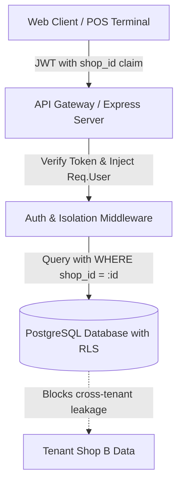

# Authentication & Security Specification: DukaanSense

**Evidence Status**: `[VERIFIED]` from prototype layout & `[INFERRED]` for production standalone security.  
**Multi-Tenant Model**: Hard isolation by `shop_id` with Row Level Security (RLS).

---

## 1. Multi-Tenant Isolation Architecture

Every merchant store exists as an isolated tenant. No merchant or cashier may query, inspect, or modify records belonging to another `shop_id`.



### Database Row Level Security (PostgreSQL) `[INFERRED]`
```sql
ALTER TABLE sales_bills ENABLE ROW LEVEL SECURITY;
ALTER TABLE products ENABLE ROW LEVEL SECURITY;
ALTER TABLE udhaar_accounts ENABLE ROW LEVEL SECURITY;

CREATE POLICY tenant_isolation_sales ON sales_bills
  FOR ALL
  TO authenticated
  USING (shop_id = current_setting('app.current_shop_id')::uuid);
```

---

## 2. Role-Based Access Control (RBAC) Matrix

| Capability / Action | Store Owner (`owner`) | Store Manager (`manager`) | Counter Cashier (`cashier`) |
|---|:---:|:---:|:---:|
| **Create New Bill (POS Checkout)** | ✅ Allowed | ✅ Allowed | ✅ Allowed |
| **Apply Bill Discount** | ✅ Allowed | ✅ Allowed (Up to ₹50) | ❌ Needs Manager Override |
| **Reverse / Refund Bill** | ✅ Allowed | ✅ Allowed | ❌ Needs Owner PIN |
| **View Daily Gross & Net Profit** | ✅ Allowed | ❌ Hidden | ❌ Hidden |
| **View / Add Shop Expenses** | ✅ Allowed | ✅ Allowed | ❌ Denied |
| **Clear Udhaar Debt Repayment** | ✅ Allowed | ✅ Allowed | ✅ Allowed (Requires Receipt) |
| **Run Gemini AI Action Check** | ✅ Allowed | ✅ Allowed | ❌ Denied |
| **Chat with Dukaan AI Co-pilot** | ✅ Allowed | ✅ Allowed | ❌ Denied |
| **Delete Master Records** | ❌ Soft-delete only | ❌ Denied | ❌ Denied |

---

## 3. Session Lifecycles & Token Security

1. **Google OAuth 2.0 (PKCE Flow)** `[OBSERVED]`:
   - Client redirects to Google OAuth endpoint.
   - Authorizes email, full name, and avatar.
   - Exchanges code on backend for secure tenant session.

2. **JWT Dual-Token Model** `[INFERRED]`:
   - **Access Token**: Short-lived (15 minutes), passed via `Authorization: Bearer <token>` or encrypted `__session` cookie. Payload: `{ userId, shopId, role, email }`.
   - **Refresh Token**: Long-lived (30 days), stored in database table `user_sessions`, delivered in `HttpOnly`, `Secure`, `SameSite=Lax` cookie.
   - **Token Revocation**: Triggered on password change, device logout, or role demotion.

3. **Protection Headers & Hardening**:
   - `Content-Security-Policy`: Restricts inline script execution and limits connections to backend API and Google APIs.
   - `X-Frame-Options: DENY`: Prevents clickjacking within iframes.
   - `Strict-Transport-Security (HSTS)`: Enforces HTTPS in production.

---

## 4. Financial Audit Logging

Any modification altering shop money, stock balances, or customer credit must write an immutable audit record:
- **`actor_id`**: User initiating mutation.
- **`action`**: e.g., `BILL_REVERSED`, `UDHAAR_CREDIT_REDUCED`, `PRICE_UPDATED`.
- **`entity_id`**: Target invoice or customer account.
- **`snapshot_before`**: Full JSON state before mutation.
- **`snapshot_after`**: Full JSON state after mutation.
- **`ip_address` & `user_agent`**: Forensic tracking.
