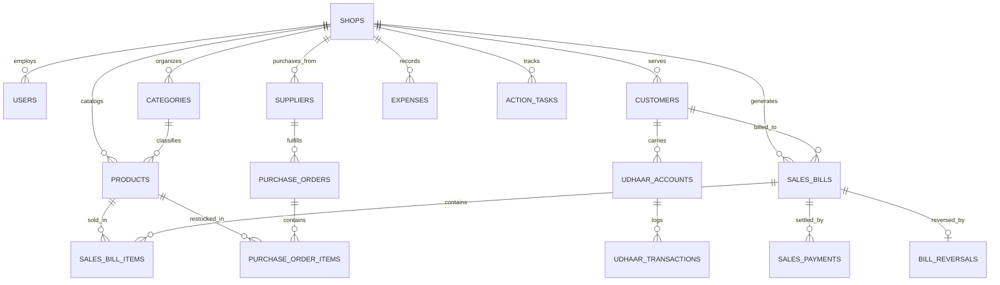

# Database Schema Specification: DukaanSense / DukaanSystem

**Evidence Status**: `[VERIFIED]` from [`data/store.js`](file:///c:/Users/Mark/Desktop/dukanSense/data/store.js) and `[INFERRED]` for relational production normalization.  
**Target RDBMS**: PostgreSQL 16+ (or Supabase Postgres)  
**Multi-Tenant Model**: Row-Level Security (RLS) via mandatory `shop_id` foreign key on every operational table.

---

## 1. Relational Entity Diagram



---

## 2. Field-by-Field Entity DDL Specifications (19 Entities)

### 1. `shops` (Tenant Root) `[VERIFIED]`
| Column | Type | Constraints | Description |
|---|---|---|---|
| `id` | `UUID` | `PRIMARY KEY DEFAULT gen_random_uuid()` | Unique shop identifier |
| `name` | `VARCHAR(100)` | `NOT NULL` | Store business name (e.g., "Patel Stores") |
| `owner_name`| `VARCHAR(100)` | `NOT NULL` | Primary merchant name ("Gurpreet Singh") |
| `currency` | `VARCHAR(5)` | `NOT NULL DEFAULT '₹'` | Default display currency |
| `phone` | `VARCHAR(20)` | `NULLABLE` | Shop primary contact |
| `created_at`| `TIMESTAMPTZ` | `NOT NULL DEFAULT now()` | Tenant provisioning date |

### 2. `users` (Staff & Merchant Accounts) `[VERIFIED]`
| Column | Type | Constraints | Description |
|---|---|---|---|
| `id` | `UUID` | `PRIMARY KEY DEFAULT gen_random_uuid()` | User auth identity |
| `shop_id` | `UUID` | `REFERENCES shops(id) ON DELETE CASCADE` | Associated store tenant |
| `email` | `VARCHAR(150)` | `NOT NULL UNIQUE` | Login email address |
| `password_hash` | `TEXT` | `NULLABLE` | Argon2/Bcrypt hash (null if OAuth) |
| `full_name`| `VARCHAR(100)` | `NOT NULL` | Display name |
| `role` | `VARCHAR(20)` | `NOT NULL DEFAULT 'owner'` | `'owner'`, `'cashier'`, `'manager'` |

### 3. `roles_permissions` (Access Matrix) `[INFERRED]`
| Column | Type | Constraints | Description |
|---|---|---|---|
| `id` | `SERIAL` | `PRIMARY KEY` | Permission ID |
| `role` | `VARCHAR(20)` | `NOT NULL` | Role identifier |
| `permission`| `VARCHAR(50)` | `NOT NULL` | e.g., `'sales:create'`, `'sales:reverse'`, `'ai:consult'` |

### 4. `categories` `[VERIFIED]`
| Column | Type | Constraints | Description |
|---|---|---|---|
| `id` | `UUID` | `PRIMARY KEY DEFAULT gen_random_uuid()` | Category ID |
| `shop_id` | `UUID` | `REFERENCES shops(id) NOT NULL` | Multi-tenant isolation |
| `name` | `VARCHAR(60)` | `NOT NULL` | e.g., "Bakery & Biscuits", "Detergent" |

### 5. `products` (Inventory Catalog) `[VERIFIED]`
| Column | Type | Constraints | Description |
|---|---|---|---|
| `id` | `VARCHAR(32)` | `PRIMARY KEY` | Product SKU code or UUID (e.g., `p1`) |
| `shop_id` | `UUID` | `REFERENCES shops(id) NOT NULL` | Tenant isolation |
| `category_id`| `UUID` | `REFERENCES categories(id)` | Product classification |
| `name` | `VARCHAR(120)` | `NOT NULL` | Brand + Variant (e.g., "Surf Excel 1kg") |
| `barcode` | `VARCHAR(64)` | `NULLABLE` | EAN-13 / UPC barcode string |
| `price` | `NUMERIC(10,2)`| `NOT NULL CHECK (price >= 0)` | Retail selling price in ₹ |
| `cost` | `NUMERIC(10,2)`| `NOT NULL CHECK (cost >= 0)` | Wholesale acquisition cost |
| `stock` | `NUMERIC(10,2)`| `NOT NULL DEFAULT 0` | Available shelf stock count |
| `reorder_level`| `NUMERIC(10,2)`| `NOT NULL DEFAULT 5` | Minimum stock trigger threshold |
| `unit` | `VARCHAR(20)` | `NOT NULL DEFAULT 'piece'` | `'piece'`, `'packet'`, `'bottle'`, `'kg'` |

### 6. `inventory_batches` (Audit Trail of Adjustments) `[INFERRED]`
| Column | Type | Constraints | Description |
|---|---|---|---|
| `id` | `UUID` | `PRIMARY KEY DEFAULT gen_random_uuid()` | Log entry ID |
| `product_id`| `VARCHAR(32)` | `REFERENCES products(id)` | Target product |
| `delta` | `NUMERIC(10,2)`| `NOT NULL` | Positive or negative quantity delta |
| `reason` | `VARCHAR(50)` | `NOT NULL` | `'sale'`, `'reversal'`, `'purchase'`, `'damage'` |

### 7. `customers` (Neighborhood Patrons) `[VERIFIED]`
| Column | Type | Constraints | Description |
|---|---|---|---|
| `id` | `UUID` | `PRIMARY KEY DEFAULT gen_random_uuid()` | Customer ID |
| `shop_id` | `UUID` | `REFERENCES shops(id) NOT NULL` | Tenant isolation |
| `name` | `VARCHAR(100)` | `NOT NULL` | e.g., "Ramesh Kumar" |
| `phone` | `VARCHAR(20)` | `NULLABLE` | Mobile number for WhatsApp |
| `notes` | `TEXT` | `NULLABLE` | General customer preferences |

### 8. `udhaar_accounts` (Credit Balances) `[VERIFIED]`
| Column | Type | Constraints | Description |
|---|---|---|---|
| `id` | `UUID` | `PRIMARY KEY DEFAULT gen_random_uuid()` | Ledger account ID |
| `customer_id`| `UUID` | `REFERENCES customers(id) UNIQUE` | 1-to-1 credit account per customer |
| `balance` | `NUMERIC(10,2)`| `NOT NULL DEFAULT 0.00` | Net outstanding debt |
| `credit_limit`| `NUMERIC(10,2)`| `NOT NULL DEFAULT 2000.00` | Max permitted credit ceiling |
| `last_purchased_at`| `TIMESTAMPTZ`| `NULLABLE` | Timestamp of most recent Udhaar bill |

### 9. `udhaar_transactions` (Repayment & Debt Ledger) `[VERIFIED]`
| Column | Type | Constraints | Description |
|---|---|---|---|
| `id` | `UUID` | `PRIMARY KEY DEFAULT gen_random_uuid()` | Ledger transaction ID |
| `account_id`| `UUID` | `REFERENCES udhaar_accounts(id)`| Parent credit account |
| `bill_id` | `VARCHAR(32)` | `REFERENCES sales_bills(id) NULLABLE` | Linked bill if debit |
| `amount` | `NUMERIC(10,2)`| `NOT NULL` | Amount added or repaid |
| `type` | `VARCHAR(10)` | `NOT NULL` | `'debit'` (bought on credit) or `'credit'` (repaid) |

### 10. `sales_bills` (Invoice Headers) `[VERIFIED]`
| Column | Type | Constraints | Description |
|---|---|---|---|
| `id` | `VARCHAR(32)` | `PRIMARY KEY` | Bill reference (e.g., `BILL-1001`) |
| `shop_id` | `UUID` | `REFERENCES shops(id) NOT NULL` | Tenant isolation |
| `customer_id`| `UUID` | `REFERENCES customers(id) NULLABLE`| Null for walk-in cash customer |
| `date` | `TIMESTAMPTZ` | `NOT NULL DEFAULT now()` | Bill creation timestamp |
| `subtotal` | `NUMERIC(10,2)`| `NOT NULL` | Sum of item gross totals |
| `discount` | `NUMERIC(10,2)`| `NOT NULL DEFAULT 0.00` | Bill-level discount |
| `total` | `NUMERIC(10,2)`| `NOT NULL` | Payable amount ($Subtotal - Discount$) |
| `total_cost`| `NUMERIC(10,2)`| `NOT NULL` | Aggregate wholesale cost of billed items |
| `payment_method`| `VARCHAR(20)`| `NOT NULL` | `'Cash'`, `'UPI'`, `'Card'`, `'Udhaar'` |
| `status` | `VARCHAR(20)` | `NOT NULL DEFAULT 'Completed'` | `'Completed'`, `'Reversed'`, `'Cancelled'` |

### 11. `sales_bill_items` (Invoice Line Items) `[VERIFIED]`
| Column | Type | Constraints | Description |
|---|---|---|---|
| `id` | `UUID` | `PRIMARY KEY DEFAULT gen_random_uuid()` | Line item ID |
| `bill_id` | `VARCHAR(32)` | `REFERENCES sales_bills(id) ON DELETE CASCADE` | Linked bill |
| `product_id`| `VARCHAR(32)` | `REFERENCES products(id)` | Billed product SKU |
| `name` | `VARCHAR(120)` | `NOT NULL` | Historical name snapshot at sale |
| `qty` | `NUMERIC(10,2)`| `NOT NULL CHECK (qty > 0)` | Quantity purchased |
| `price` | `NUMERIC(10,2)`| `NOT NULL` | Historical unit selling price |
| `cost` | `NUMERIC(10,2)`| `NOT NULL` | Historical unit cost price |

### 12. `sales_payments` (Multi-Tender Splits) `[INFERRED]`
| Column | Type | Constraints | Description |
|---|---|---|---|
| `id` | `UUID` | `PRIMARY KEY DEFAULT gen_random_uuid()` | Payment record ID |
| `bill_id` | `VARCHAR(32)` | `REFERENCES sales_bills(id)` | Linked bill |
| `method` | `VARCHAR(20)` | `NOT NULL` | Tender method (`Cash`, `UPI`, `Card`, `Udhaar`) |
| `amount` | `NUMERIC(10,2)`| `NOT NULL` | Tender amount attributed |

### 13. `bill_reversals` (Returns & Cancellation Audit) `[VERIFIED]`
| Column | Type | Constraints | Description |
|---|---|---|---|
| `id` | `UUID` | `PRIMARY KEY DEFAULT gen_random_uuid()` | Reversal entry ID |
| `bill_id` | `VARCHAR(32)` | `REFERENCES sales_bills(id) UNIQUE` | Unique 1-to-1 link to bill |
| `reversed_by`| `UUID` | `REFERENCES users(id)` | Staff member authorizing reversal |
| `reason` | `TEXT` | `NOT NULL DEFAULT 'Customer return'` | Return explanation |
| `reversed_at`| `TIMESTAMPTZ`| `NOT NULL DEFAULT now()` | Timestamp of inventory restoration |

### 14. `suppliers` (Wholesale Vendors) `[VERIFIED]`
| Column | Type | Constraints | Description |
|---|---|---|---|
| `id` | `UUID` | `PRIMARY KEY DEFAULT gen_random_uuid()` | Supplier ID |
| `shop_id` | `UUID` | `REFERENCES shops(id) NOT NULL` | Tenant isolation |
| `name` | `VARCHAR(100)` | `NOT NULL` | Supplier business name |
| `contact_person`| `VARCHAR(80)`| `NULLABLE` | Sales representative name |
| `phone` | `VARCHAR(20)` | `NULLABLE` | WhatsApp/Calling contact |

### 15. `purchase_orders` (Stock Procurement) `[VERIFIED]`
| Column | Type | Constraints | Description |
|---|---|---|---|
| `id` | `VARCHAR(32)` | `PRIMARY KEY` | PO reference (e.g., `PO-2026-001`) |
| `shop_id` | `UUID` | `REFERENCES shops(id) NOT NULL` | Tenant isolation |
| `supplier_id`| `UUID` | `REFERENCES suppliers(id)` | Vendor link |
| `status` | `VARCHAR(20)` | `NOT NULL DEFAULT 'Received'` | `'Draft'`, `'Ordered'`, `'Received'` |
| `total_amount`| `NUMERIC(10,2)`| `NOT NULL DEFAULT 0.00` | Aggregate purchase cost |

### 16. `purchase_order_items` `[INFERRED]`
| Column | Type | Constraints | Description |
|---|---|---|---|
| `id` | `UUID` | `PRIMARY KEY DEFAULT gen_random_uuid()` | Item ID |
| `po_id` | `VARCHAR(32)` | `REFERENCES purchase_orders(id) ON DELETE CASCADE`| Linked PO |
| `product_id`| `VARCHAR(32)` | `REFERENCES products(id)` | Target product |
| `qty_received`| `NUMERIC(10,2)`| `NOT NULL CHECK (qty_received > 0)` | Received count |
| `unit_cost` | `NUMERIC(10,2)`| `NOT NULL` | Purchase wholesale cost |

### 17. `expenses` (Shop Overheads) `[VERIFIED]`
| Column | Type | Constraints | Description |
|---|---|---|---|
| `id` | `VARCHAR(32)` | `PRIMARY KEY` | Expense identifier (e.g., `e1`) |
| `shop_id` | `UUID` | `REFERENCES shops(id) NOT NULL` | Tenant isolation |
| `title` | `VARCHAR(120)` | `NOT NULL` | e.g., "Shop electricity bill", "Staff chai" |
| `amount` | `NUMERIC(10,2)`| `NOT NULL CHECK (amount > 0)` | Overhead expenditure in ₹ |
| `category` | `VARCHAR(50)` | `NOT NULL DEFAULT 'Daily Operations'`| Utilities, Chai, Packaging, Rent |
| `date` | `DATE` | `NOT NULL DEFAULT CURRENT_DATE`| Expense date |

### 18. `action_tasks` (Daily Action Engine Records) `[VERIFIED]`
| Column | Type | Constraints | Description |
|---|---|---|---|
| `id` | `VARCHAR(64)` | `PRIMARY KEY` | Task ID (e.g., `t1` or `ai-1729158-1`) |
| `shop_id` | `UUID` | `REFERENCES shops(id) NOT NULL` | Tenant isolation |
| `title` | `VARCHAR(150)` | `NOT NULL` | Concise task instruction |
| `category` | `VARCHAR(60)` | `NOT NULL` | Stock Alert, Credit/Udhaar, Margin |
| `type` | `VARCHAR(20)` | `NOT NULL` | `'rule'` (factual) or `'ai'` (Gemini) |
| `priority` | `VARCHAR(20)` | `NOT NULL DEFAULT 'medium'` | `'high'`, `'medium'`, `'low'` |
| `reason` | `TEXT` | `NOT NULL` | Data evidence supporting the action |
| `status` | `VARCHAR(20)` | `NOT NULL DEFAULT 'open'` | `'open'`, `'done'`, `'closed'` |
| `created_at`| `TIMESTAMPTZ` | `NOT NULL DEFAULT now()` | Generation timestamp |

### 19. `audit_logs` (Financial Mutation History) `[INFERRED]`
| Column | Type | Constraints | Description |
|---|---|---|---|
| `id` | `BIGSERIAL` | `PRIMARY KEY` | Immutable sequential ID |
| `shop_id` | `UUID` | `REFERENCES shops(id) NOT NULL` | Tenant isolation |
| `actor_id` | `UUID` | `REFERENCES users(id) NULLABLE` | Acting staff member |
| `action` | `VARCHAR(60)` | `NOT NULL` | e.g., `'BILL_CREATED'`, `'BILL_REVERSED'`, `'UDHAAR_REPAID'` |
| `payload` | `JSONB` | `NOT NULL` | Full snapshot before/after mutation |
| `timestamp`| `TIMESTAMPTZ` | `NOT NULL DEFAULT now()` | System UTC timestamp |

---

## 3. Database Indexes Strategy

```sql
-- Fast multi-tenant partition filters
CREATE INDEX idx_products_shop ON products(shop_id);
CREATE INDEX idx_sales_bills_shop_date ON sales_bills(shop_id, date DESC);
CREATE INDEX idx_action_tasks_shop_status ON action_tasks(shop_id, status);
CREATE INDEX idx_udhaar_accounts_shop ON udhaar_accounts(customer_id);

-- Rapid text and barcode lookups
CREATE INDEX idx_products_barcode ON products(barcode) WHERE barcode IS NOT NULL;
CREATE INDEX idx_sales_bills_payment_method ON sales_bills(payment_method);
```
